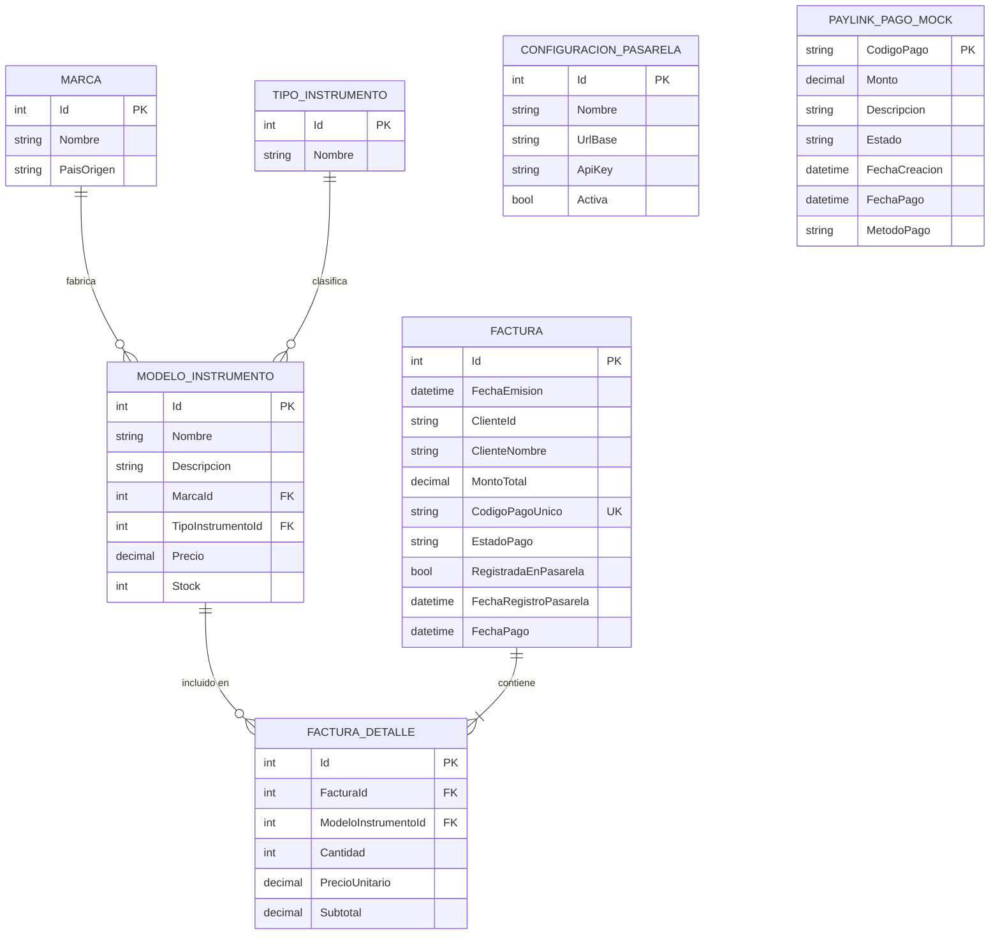
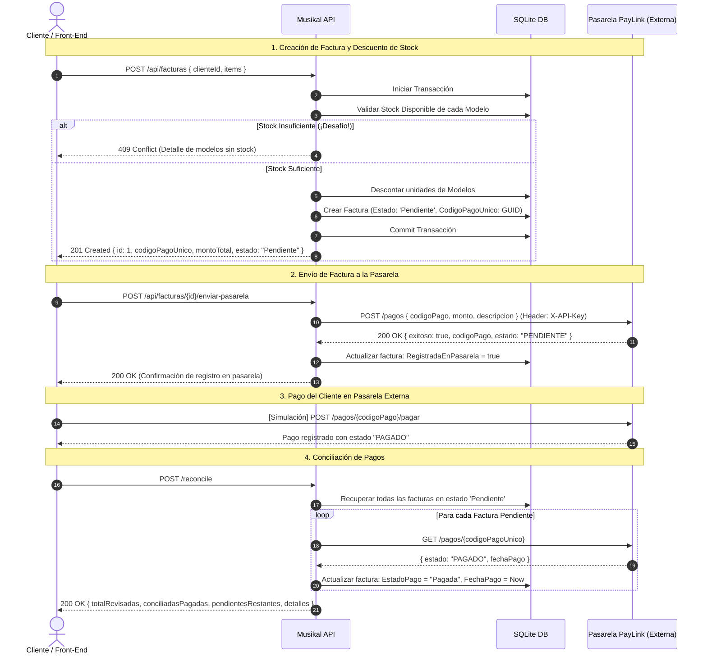

# Musikal API - API REST Tienda de Instrumentos Musicales

API RESTful desarrollada en **.NET 10 (C#)** con **Entity Framework Core** y **SQLite** para la administración del catálogo de instrumentos musicales, gestión del flujo de facturación con control atómico de stock y conciliación con la pasarela de pagos externa **PayLink**.

---

## Índice

1. [Características Principales](#características-principales)
2. [Arquitectura y Tecnologías](#arquitectura-y-tecnologías)
3. [Modelo de Base de Datos](#modelo-de-base-de-datos)
4. [Catálogo de Endpoints](#catálogo-de-endpoints)
5. [Documentación de Flujo: Envío y Conciliación con Pasarela](#documentación-de-flujo-envío-y-conciliación-con-pasarela)
6. [Resolución del ¡Desafío!: Control Estricto de Stock](#resolución-del-desafío-control-estricto-de-stock)
7. [Simulador de Pasarela (PayLink Mock)](#simulador-de-pasarela-paylink-mock)
8. [Instrucciones de Ejecución y Pruebas](#instrucciones-de-ejecución-y-pruebas)

---

## Características Principales

- **Gestión de Catálogo Completa (CRUD):**
  - **Marcas:** ID, Nombre, País de Origen.
  - **Tipos de Instrumento:** ID, Nombre (Cuerda, Percusión, Viento, Teclado, etc.).
  - **Modelos de Instrumento:** ID, Nombre, Descripción, Marca, Tipo, Precio y Stock Disponible. Búsquedas y filtros por Tipo, Marca y texto.
- **Gestión de Facturación y Ventas:**
  - Emisión de facturas con múltiples ítems.
  - Descuento automático de inventario por modelo vendido.
  - Generación de un **Código de Pago Único** (GUID) para la pasarela de pagos.
  - Estados de factura: `Pendiente`, `Pagada`, `Cancelada`.
- **¡Desafío Cumplido!:** Control previo de disponibilidad de stock que impide la creación de facturas si el stock es insuficiente, retornando un error HTTP `409 Conflict` con el detalle explícito de qué modelos faltan y en qué cantidad.
- **Integración con Pasarela de Pagos (PayLink):**
  - Configuración almacenable (URL base, credenciales/API Key, estado).
  - Envío de factura a la pasarela (registro de obligación de pago).
  - Mecanismo de conciliación periódica o manual (`POST /reconcile` o `POST /api/facturas/reconciliar`) que consulta a la pasarela y actualiza las facturas a `Pagada`.
- **Simulador / Mock Integrado:** Permite probar el ciclo completo de vida del pago sin depender de un servidor externo.
- **Documentación Interactiva:** Swagger UI habilitado en la raíz (`/`).

---

## Arquitectura y Tecnologías

- **Plataforma:** .NET 10 / ASP.NET Core Web API
- **ORM:** Entity Framework Core 10
- **Base de Datos:** SQLite (`musikal.db`)
- **Documentación:** Swagger / OpenAPI con Swashbuckle
- **Patrón de Diseño:** Clean Architecture con Controladores, Servicios de Dominio, DTOs y Contexto EF Core.

---

## Modelo de Base de Datos

### Diagrama Entidad-Relación (ERD)



---

## Catálogo de Endpoints

### 1. Marcas (`/api/marcas`)
| Método | Endpoint | Descripción |
|---|---|---|
| `GET` | `/api/marcas` | Listado de todas las marcas con conteo de modelos. |
| `GET` | `/api/marcas/{id}` | Detalle de una marca por ID. |
| `GET` | `/api/marcas/{id}/modelos` | Listado de todos los modelos pertenecientes a una marca. |
| `POST` | `/api/marcas` | Crea una nueva marca (Requiere rol Admin). |
| `PUT` | `/api/marcas/{id}` | Actualiza datos de una marca existente (Requiere rol Admin). |
| `DELETE` | `/api/marcas/{id}` | Elimina una marca si no tiene modelos vinculados (Requiere rol Admin). |

### 2. Tipos de Instrumento (`/api/tipos`)
| Método | Endpoint | Descripción |
|---|---|---|
| `GET` | `/api/tipos` | Listado de todos los tipos de instrumentos. |
| `GET` | `/api/tipos/{id}` | Detalle de un tipo por ID. |
| `GET` | `/api/tipos/{id}/modelos` | Listado de todos los modelos pertenecientes a un tipo. |
| `POST` | `/api/tipos` | Crea un nuevo tipo (Requiere rol Admin). |
| `PUT` | `/api/tipos/{id}` | Actualiza un tipo existente (Requiere rol Admin). |
| `DELETE` | `/api/tipos/{id}` | Elimina un tipo si no tiene modelos asociados (Requiere rol Admin). |

### 3. Modelos de Instrumento (`/api/modelos`)
| Método | Endpoint | Descripción |
|---|---|---|
| `GET` | `/api/modelos` | Consulta y búsqueda de modelos. Parámetros opcionales: `?tipoId=1`, `?marcaId=2`, `?buscar=Stratocaster`. |
| `GET` | `/api/modelos/{id}` | Detalle de un modelo con datos de marca y tipo. |
| `GET` | `/api/modelos/tipo/{tipoId}` | Listado directo de modelos por tipo de instrumento. |
| `GET` | `/api/modelos/marca/{marcaId}` | Listado directo de modelos por marca. |
| `POST` | `/api/modelos` | Registra un nuevo modelo con stock inicial y precio (Requiere rol Admin). |
| `PUT` | `/api/modelos/{id}` | Actualiza las propiedades de un modelo (Requiere rol Admin). |
| `DELETE` | `/api/modelos/{id}` | Elimina un modelo si no está presente en facturas (Requiere rol Admin). |

### 4. Facturación y Ventas (`/api/facturas`)
| Método | Endpoint | Descripción |
|---|---|---|
| `GET` | `/api/facturas` | Listado de facturas emitidas (filtro opcional `?estado=Pendiente`). |
| `GET` | `/api/facturas/{id}` | Detalle de la factura con desglose de ítems. |
| `POST` | `/api/facturas` | Emisión de factura con validación y descuento de stock (¡Desafío!). |
| `POST` | `/api/facturas/{id}/enviar-pasarela` o `.../enviar` | Envía la factura a PayLink con su Código de Pago Único y Monto. Retorna 502 si la pasarela falla. |
| `POST` | `/reconcile` o `/api/facturas/reconciliar` | Proceso de conciliación de pagos contra la pasarela externa. |

### 5. Configuración de Pasarela (`/api/pasarela`)
| Método | Endpoint | Descripción |
|---|---|---|
| `GET` | `/api/pasarela` | Obtiene la configuración activa de conexión a PayLink. |
| `GET` | `/api/pasarela/{id}` | Obtiene una configuración de pasarela específica por ID. |
| `POST` | `/api/pasarela` | Registra una nueva configuración de pasarela. |
| `PUT` | `/api/pasarela` o `/api/pasarela/{id}` | Actualiza la URL base y credenciales de acceso a PayLink. |

### 6. Autenticación Simulada (`/api/auth`)
| Método | Endpoint | Descripción |
|---|---|---|
| `POST` | `/api/auth/login` | Inicia sesión con usuarios de prueba (`admin`/`admin123`, `vendedor`/`vendedor123`) y genera un token simulado. |
| `GET` | `/api/auth/usuarios` | Lista los usuarios de prueba y roles disponibles. |
| `GET` | `/api/auth/me` | Retorna el perfil y rol detectado según headers `Authorization` o `X-User-Role`. |

### 7. Simulador PayLink Mock (`/api/paylink-mock`)
| Método | Endpoint | Descripción |
|---|---|---|
| `POST` | `/api/paylink-mock/pagos` | Endpoint externo que recibe el registro de pago. |
| `GET` | `/api/paylink-mock/pagos/{codigoPago}` | Endpoint externo para consultar el estado del pago. |
| `POST` | `/api/paylink-mock/pagos/{codigoPago}/pagar` | Simula la confirmación de pago por parte del cliente. |
| `POST` | `/api/paylink-mock/pagos/{codigoPago}/rechazar`| Simula el rechazo de la transacción. |
| `GET` | `/api/paylink-mock/pagos` | Listado de todas las transacciones en PayLink. |

---

## Documentación de Flujo: Envío y Conciliación con Pasarela

### Diagrama de Secuencia



### Detalle de las Peticiones HTTP

#### 1. Creación de Factura
- **URL:** `POST /api/facturas`
- **Request Body:**
  ```json
  {
    "clienteId": "CLI-102",
    "clienteNombre": "Carlos Santana",
    "items": [
      {
        "modeloInstrumentoId": 1,
        "cantidad": 2
      }
    ]
  }
  ```
- **Response `201 Created`:**
  ```json
  {
    "id": 1,
    "fechaEmision": "2026-11-16T11:13:46Z",
    "clienteId": "CLI-102",
    "clienteNombre": "Carlos Santana",
    "montoTotal": 1700.00,
    "codigoPagoUnico": "9cd855ee4ce749eca07c752ad52b9faf",
    "estadoPago": "Pendiente",
    "registradaEnPasarela": false,
    "detalles": [
      {
        "id": 1,
        "modeloInstrumentoId": 1,
        "modeloNombre": "Stratocaster Player Series",
        "cantidad": 2,
        "precioUnitario": 850.00,
        "subtotal": 1700.00
      }
    ]
  }
  ```

#### 2. Envío a la Pasarela (Registro de Pago)
- **URL:** `POST /api/facturas/1/enviar-pasarela`
- **Llamada externa realizada por Musikal API hacia PayLink:**
  - **Método y URL:** `POST http://localhost:5000/api/paylink-mock/pagos`
  - **Headers:** `X-API-Key: paylink_live_secret_key_musikal_2026`, `Content-Type: application/json`
  - **Payload:**
    ```json
    {
      "codigoPago": "9cd855ee4ce749eca07c752ad52b9faf",
      "monto": 1700.00,
      "descripcion": "Pago Factura #1 - Cliente: Carlos Santana (CLI-102)"
    }
    ```
- **Respuesta recibida:**
  ```json
  {
    "exitoso": true,
    "codigoPago": "9cd855ee4ce749eca07c752ad52b9faf",
    "mensaje": "Obligación de pago registrada exitosamente en PayLink. Lista para pago del cliente.",
    "estado": "PENDIENTE"
  }
  ```

#### 3. Conciliación (`POST /reconcile` o `POST /api/facturas/reconciliar`)
- **Llamada externa realizada por Musikal API hacia PayLink:**
  - **Método y URL:** `GET http://localhost:5000/api/paylink-mock/pagos/9cd855ee4ce749eca07c752ad52b9faf`
- **Respuesta devuelta por el Endpoint de Conciliación:**
  ```json
  {
    "fechaEjecucion": "2026-11-16T11:13:47Z",
    "totalFacturasPendientesRevisadas": 1,
    "facturasConciliadasPagadas": 1,
    "facturasAunPendientes": 0,
    "facturasConErrorConsulta": 0,
    "detalles": [
      {
        "facturaId": 1,
        "codigoPagoUnico": "9cd855ee4ce749eca07c752ad52b9faf",
        "monto": 1700.00,
        "estadoAnterior": "Pendiente",
        "estadoNuevo": "Pagada",
        "estadoEnPasarela": "PAGADO",
        "observacion": "Pago verificado y conciliado exitosamente."
      }
    ]
  }
  ```

---

## Resolución del ¡Desafío!: Control Estricto de Stock

Cuando un cliente intenta emitir una factura solicitando más unidades de las disponibles en inventario:
1. La API **detiene la transacción inmediatamente**.
2. **No descuenta** ninguna unidad de ningún producto.
3. **No emite** la factura ni genera código de pago.
4. Responde con un código HTTP `409 Conflict` y un payload descriptivo:

```json
{
  "mensaje": "No es posible generar la factura debido a stock insuficiente en: 'Stratocaster Player Series' (Disponible: 10, Solicitado: 9999).",
  "erroresStock": [
    {
      "modeloInstrumentoId": 1,
      "modeloNombre": "Stratocaster Player Series",
      "stockDisponible": 10,
      "cantidadSolicitada": 9999,
      "faltante": 9989
    }
  ]
}
```

---

## Simulador de Pasarela (PayLink Mock)

Para facilitar la prueba end-to-end sin requerir desplegar un servidor externo, la API incluye el controlador `PayLinkMockController`:

- Al enviar una factura, PayLink almacena el pago en estado `PENDIENTE`.
- Mediante `POST /api/paylink-mock/pagos/{codigoPago}/pagar`, se simula que el cliente abonó la factura a través de la pasarela.
- Al ejecutar `POST /reconcile`, Musikal API consulta a PayLink y actualiza automáticamente el estado de la factura a `Pagada`.

---

## Instrucciones de Ejecución y Pruebas

### 1. Iniciar la API
Abre una terminal en el directorio del proyecto y ejecuta:

```powershell
cd MusikalApi
dotnet run
```

La API estará escuchando en `http://localhost:5000`.

### 2. Abrir Swagger UI
Ingresa en tu navegador web a:
👉 **[http://localhost:5000](http://localhost:5000)** (o `http://localhost:5000/swagger`)

Podrás interactuar visualmente con todos los endpoints del catálogo, la facturación y la pasarela.

### 3. Ejecutar la Suite de Pruebas Automatizadas
Desde el directorio raíz del proyecto (`MusikalApi`), ejecuta:

```powershell
powershell -ExecutionPolicy Bypass -File .\test_api.ps1
```

Este script ejecuta automáticamente de principio a fin:
1. Consulta y listado del catálogo (Marcas, Tipos, Modelos).
2. Filtros de modelos por Tipo (`?tipoId=1` y `/api/modelos/tipo/1`).
3. Filtros de modelos por Marca (`/api/modelos/marca/1`).
4. Autenticación simulada (`POST /api/auth/login`) con token y roles.
5. Test del **¡Desafío!** con intento de compra por encima de stock disponible (verificando rechazo HTTP 409 Conflict).
6. Emisión de factura válida y descuento atómico de stock.
7. Envío de factura a PayLink (`POST /api/facturas/{id}/enviar-pasarela`).
8. Simulación del pago del cliente en PayLink.
9. Ejecución de la conciliación (`POST /reconcile`).
10. Verificación final de la factura en estado `Pagada`.
11. Verificación de configuración de pasarela (`GET /api/pasarela`).
